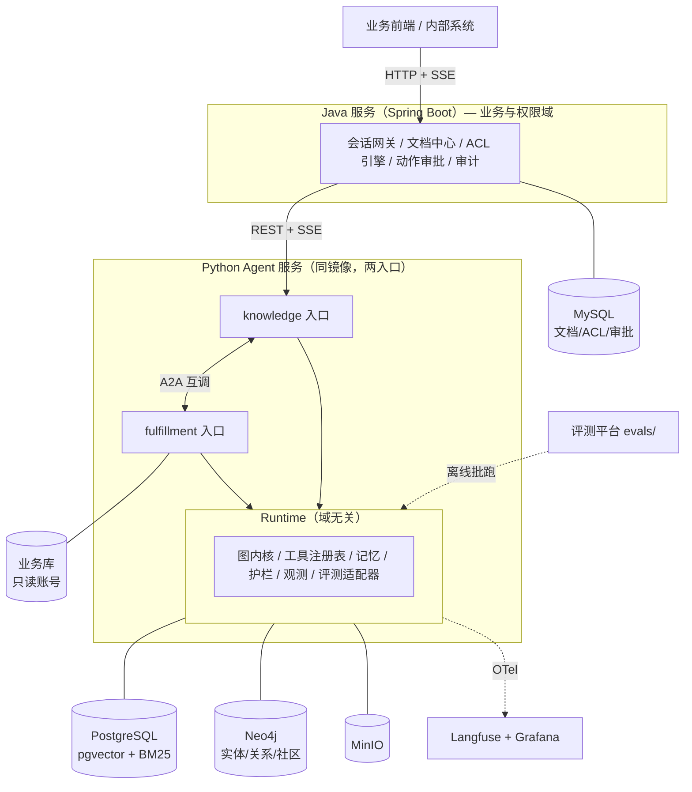

# KnowOps Agent — 权限感知的双域 Agent 中台

> **Know**（知识域）+ **Ops**（履约运维域）= 两个业务域，一套 Agent 运行时，一套评测体系。

一句话定位：把「域无关的 Agent 运行时」和「域相关的业务能力」彻底分开，
让知识问答和履约排障跑在同一个内核上，通过 **A2A** 而不是函数调用互相协作，
并且两条链路都能被同一套评测体系量化。

---

## 一、这个项目到底在做什么

不是"做了两个 Agent"，而是**回答三个工程问题**：

| 问题 | 本项目的答案 | 证明方式 |
|---|---|---|
| 一套 Agent 内核能不能支撑差异很大的业务域？ | 能。内核与域通过 Domain Pack 解耦，共享约 70% 代码（01 §3：Runtime + 评测 + 观测三块 100% 共享，占代码量 60%~70%） | 同一镜像两个入口，两个域独立扩缩容 |
| 两个 Agent 之间该怎么协作？ | A2A。域边界即服务边界，且任务是有状态、可中断、要回放的 | 一次请求跨越 2 个进程，Task 状态迁移全程可见 |
| 效果的好坏能不能被量化和归因？ | 能。四套数据集、四层指标、十类错误归因 | 每次优化都给出"涨多少、贵多少、贵在哪" |

**为什么场景不是一个而是两个**：只做知识问答，会被看成"又一个 RAG demo"；
只做排障，覆盖不到文档解析与图谱。两个域一起做，才逼出"什么是共性、什么是差异"这层抽象——
而这层抽象，才是平台和 demo 的分水岭。

---

## 二、两个域的真实差异（不是硬凑）

| 维度 | 知识域 | 履约排障域 |
|---|---|---|
| 输入 | 自然语言问题 | 订单号 / 异常码 / 用户描述 |
| 核心不确定性 | 证据够不够 | 根因在哪 |
| 迭代模式 | **广度优先**：检索 → 评估 → 再检索 | **深度优先**：假设 → 验证 → 排除 |
| 工具性质 | 只读检索 | 只读查询 + 待执行的写动作 |
| 人机协作 | 一般不需要 | **必须**：动作执行前要人工确认 |
| 成功判据 | 答案正确 + 可引用 | 根因正确 + 动作正确 + 无副作用 |
| 评测方式 | 离线黄金集 | 历史工单回放 + 沙箱执行 |
| 权限粒度 | 文档 ACL | 数据行级 / 字段级 + 操作审批 |

这两行的差异足够大，大到"必须做两套评测、两套护栏、两种停止条件"；
又足够小，小到"能共用同一个状态机模板和同一个工具注册表"。
**这个"足够大又足够小"的区间，就是平台化的价值所在。**

---

## 三、架构



关键点：**两个域是两个可部署单元，不是一个进程里的两个函数**。
因为它们要独立扩缩容（知识域吃检索、排障域吃工具调用）、独立发布、独立故障隔离。

---

## 四、能力映射（对上 JD 四条）

| JD 要求 | 项目模块 | 可验收的证据 |
|---|---|---|
| 1. Agent 项目实际开发与部署 | Docker Compose 一键起、同镜像多入口、SSE 流式、限流降级、灰度 | `deploy/` + 压测报告（20 并发、P95 < 4s） |
| 2. 评测体系建设（评测集/指标/实验平台/归因） | `evals/`：知识域四套集 + 排障域回放集 | 3 组对比实验 + 双域归因看板 |
| 3. 文档解析、混合检索、GraphRAG、Agentic RAG | `domains/knowledge/`（深做） | 选型对比表 + Recall@10 + 多跳提升数据 |
| 4. planning / tool calling / memory / multi-agent / A2A | `runtime/` + `domains/fulfillment/`（完整做） | 一条跨 2 进程的完整 trace |

---

## 五、主次策略（控制工作量的关键）

双域最大的风险是"两个都做不深"。所以明确分工：

| 域 | 深度 | 承担什么 | 不做什么 |
|---|---|---|---|
| **知识域** | **深** | 解析质量、混合检索、GraphRAG、Agentic RAG、权限内建 | 不做多模态、不做文档生成 |
| **排障域** | **完整但克制** | 工具调用、假设验证式规划、HITL 审批、A2A 协作 | 不做真实写操作、不做实时流式日志 |
| **共用** | 打磨 | 图内核、工具注册表、记忆、护栏、观测、评测框架 | 不做多租户、不做权限管理后台 |

判断标准：**知识域撑第 3 条 JD 的深度，排障域撑第 4 条 JD 的广度。**
两边都不追求"功能全"，只追求"每个机制都能讲清取舍"。

---

## 六、目录规划

```
knowops-agent/
├─ java-service/                   # Spring Boot：上传、ACL、Agent 网关（REST/SSE）
│  ├─ contract/                    # codegen 生成的契约 DTO/接口（api/openapi.yaml → Java）
│  └─ app/                         # 业务服务：三接口 + 主体解析 + SSE 转发（10 条单测）
├─ agent-service/                  # Python 单一镜像，两个入口
│  ├─ runtime/                     # 域无关内核（单文件模块，硬约束：不出现域名）
│  │  ├─ graph.py                  # 状态机模板、节点包装（埋点/预算不可绕过）
│  │  ├─ registry.py               # 工具注册表、schema 校验、超时重试
│  │  ├─ memory.py                 # 工作 / 语义 / 情景记忆（见 docs/07）
│  │  ├─ guard.py                  # 注入检测、脱敏、动作白名单
│  │  ├─ events.py                 # SSE 事件汇聚 + 预算账本（顺序守卫）
│  │  ├─ prompts.py                # Prompt 库（加载/渲染/指纹）
│  │  ├─ llm.py                    # 模型抽象（MockProvider / API 路由）
│  │  ├─ tracing.py                # OTel 埋点（span 树可还原）
│  │  └─ config.py                 # Domain Pack 加载、Settings
│  ├─ domains/
│  │  ├─ knowledge/                # Domain Pack：domain.yaml + graph/nodes/tools
│  │  └─ fulfillment/              # Domain Pack：domain.yaml + graph/nodes/tools
│  ├─ prompts/                     # Prompt 资产：manifest.yaml + 各域模板（见 docs/12）
│  ├─ recordings/                  # mock 回放录制（models.yaml 的 fallback.mock）
│  ├─ api/
│  │  ├─ main_knowledge.py         # 入口 A（:8001）
│  │  └─ main_fulfillment.py       # 入口 B（:8002）
│  └─ tests/                       # pytest：41 条
├─ evals/                          # 评测平台（双域共用框架）
├─ api/                            # 服务间契约：openapi.yaml（唯一真相源）
├─ config/                         # 可执行配置：models / parse / prompts
├─ deploy/                         # compose、初始化 SQL、ACL 冒烟
├─ scripts/                        # 跨平台任务器（Makefile 只是它的薄封装）
└─ docs/
```

---

## 七、里程碑速览

| 阶段 | 目标 | 验收（目标值） |
|---|---|---|
| M0 | 骨架 + 域抽象定稿 | 两入口能起，`/healthz` 通，Domain Pack 接口定型 |
| M1 | 知识域窄链路 + 检索基线 | 解析成功率 ≥ 95%，Recall@10 ≥ 0.85 |
| M2 | 知识域 Agentic RAG | 正确率 +8pt，成本增幅 < 40% |
| M3 | 知识域 GraphRAG | 多跳子集 +10pt，建图成本可核算 |
| M4 | 排障域 + A2A | 根因 Top-1 ≥ 70%，跨 2 进程链路可回放 |
| M5 | 评测平台 + 可观测 | 3 组实验可复现，错误可在 10 分钟内归因 |
| M6 | 部署与压测 | 一键起，20 并发 P95 < 4s，越权泄漏率 = 0、危险动作出现率 = 0 |

详见 `docs/04-里程碑与面试映射.md`。

---

## 八、文档索引

| 文档 | 内容 |
|---|---|
| `docs/01-总体设计.md` | 分层、Domain Pack 抽象、两个状态机、A2A（四层协议边界）、非功能设计 |
| `docs/02-技术选型.md` | 解析 / 检索存储 / 嵌入 / GraphRAG / 编排 / 评测 / 观测 / 部署，含换型触发条件 |
| `docs/03-评测体系.md` | 双域评测集、四层指标、E1–E10 与 F1–F7 归因、CI 门禁 |
| `docs/04-里程碑与面试映射.md` | M0–M6 拆解、最小可讲版本、面试叙事与追问答法 |
| `docs/05-权限设计.md` | **本项目的招牌**：条件求值 + 例外集合、检索下推、缓存策略、链路贯穿、越权验证 |
| `docs/06-存储设计与数据归属.md` | 各库职责、表清单、CQRS 单向派生、一致性策略、本地简化方案 |
| `docs/07-记忆与会话设计.md` | **Memory 三层、上下文压缩四层与三个陷阱、多轮对话四表、自研 vs 复用边界** |
| `docs/08-模型接入方案.md` | LLM / Embedding / OCR 三类模型的接入矩阵、版本一致性、抽象层、成本与降级 |
| `docs/09-文档解析设计.md` | **四层路线（直取/管道/VLM/双后端）、级联路由、统一 IR、许可证维度** |
| `docs/10-部署形态与硬件配置.md` | **最终形态：1 个 PG 容器 + 3 个进程 + 全 API；三档硬件配置、内存预算、转私有部署的触发条件** |
| `docs/11-审计与待办.md` | **文档自审结果**：12 处内部矛盾已修、8 个设计缺口与补齐时点（第 1/2/7 条已补） |
| `docs/12-Prompt治理.md` | **Prompt 作为一等资产**：三种 hash 分工、变量契约、三档灰度、`config_version` 回滚 |
| `docs/13-服务间契约.md` | **Java ↔ Python 边界**：`subject_ctx` 透传、SSE 事件协议、超时/幂等/取消、错误码、双向 codegen |
| `docs/14-Span规范.md` | **可观测**：span 命名与属性、Span Link 处理中断恢复、E1–E10 / F1–F7 逐条归因映射 |
| `api/openapi.yaml` | **契约唯一真相源**：7 个路径、20 个 schema、SSE 事件用 `x-sse-event-types` 描述 |
| `deploy/init/01_schema.sql` | **M0 数据模型定稿**：三 schema 归属、`jsonb_ops`（不能用 `jsonb_path_ops`）、HNSW 参数、outbox |
| `deploy/smoke/01_acl_smoke.sql` | ACL 冒烟 4 项断言：public / 部门祖先链 / 审批例外 / 空数组边界 |
| `resume/resume.tex` | 简历（本项目作为第一个项目；含面试口径的数据来源说明） |
| `docs/adr/` | 架构决策记录，每条含背景、备选方案、否决理由与重审触发条件 |
| `config/models.yaml` | **可执行配置**：按角色路由、embedding 三锁、降级链、预算熔断、成本参考 |
| `config/parse.yaml` | **可执行配置**：`parse_mode: local` 全本地、按页四路路由、Docling 主力 / MinerU 兜底、质量闸门、表格链、清洗规则 |
| `config/prompts.yaml` | **可执行配置**：prompt 门禁阈值、三档灰度、自动回滚红线、semver 规则、lock 策略 |
| `config/.env.example` | 密钥模板（只需 DeepSeek + 硅基流动两个 key 跑通全链路） |

---

## 九、怎么跑起来（M0 + M1 检索现状）

> M0 已完整落地：数据模型、服务间契约、运行时内核、两个最小域、双入口 `/healthz`。
> M1 已落地：文档解析（四路路由 + 质量闸门）、语义分块（small-to-big）、混合检索
> （PG 上 pgvector dense + pg_search BM25 + RRF，鉴权下推到同一条 SQL）。
> 没有 Docker / 没有 key 也能跑：检索自动回落内存后端，模型自动回落 mock。

```bash
# 0) 装依赖（运行时 + 开发）
pip install -r requirements.txt -r requirements-dev.txt

# 1) 起 PG（paradedb：自带 pgvector + pg_search），首次启动自动建表 + 建 BM25 索引 + 灌种子
python scripts/kw.py up          # 等价 make up；不需要 docker 也能跑下面除 smoke-db 外的一切

# 2) 验鉴权：public / 部门祖先链 / 审批例外 / 空数组边界，4 项断言必须全过
python scripts/kw.py smoke-db

# 3) 把样例语料灌进 PG（解析 → 分块 → 写 write/read 表，含 bge-m3 向量）
python scripts/kw.py ingest-pg

# 4) PG 真库自检：扩展 / 索引 / 数据量 / 哪条检索路活着 / 两种身份的召回差异
python scripts/kw.py verify-pg --acl

# 5) 一键演示（检索层权限对比 + 端到端 SSE）；加 KW_LLM_MODE=online 用真模型作答
python scripts/kw.py demo
KW_LLM_MODE=online python scripts/kw.py demo

# 6) 契约 → 双端类型（不需要数据库、不需要 docker）
python scripts/kw.py codegen

# 7) 自检：openapi 引用 + operationId + SQL 语法 + pydantic 的 extra="forbid" + prompt 指纹 + 抽象隔离
python scripts/kw.py verify

# 8) 单元测试（91 条：契约 / 事件顺序 / 任务恢复 / 抽象隔离 / 预算硬停 / 解析 / 分块 / 检索）
python scripts/kw.py test

# 9) M0 端到端验收（双域假链路 + span 树关联，18 项断言）
python scripts/kw.py smoke-m0

# 10) 起服务（mock 模型，无网络）
python scripts/kw.py serve-knowledge      # :8001，/healthz + /v1/knowledge/answers
python scripts/kw.py serve-fulfillment    # :8002，/healthz + /v1/fulfillment/tasks

# 11) Java 业务服务（上传 / ACL 计算 / Agent 网关；需要 JDK17 + Maven）
python scripts/kw.py java-build           # 构建 + 安装 contract DTO
python scripts/kw.py java-test            # 10 条单测：主体解析 / 契约反序列化 / 上传
```

`scripts/kw.py` 是唯一实现，`Makefile` 只是薄封装——**Windows 默认没有 make**，两套实现必然漂移。
Windows 的坑已在 `deploy/docker-compose.yml` 处理（5433 端口避开本机 PostgreSQL、named volume 不挂 `/mnt/c`）；
WSL2 的 `memory=10GB` 要自己在 `.wslconfig` 里设（`10` §4），这条 compose 管不了。

真机部署时另外三条（都是 2026-11-04 实测踩出来的）：

- **数据卷挂载点变了**：ParadeDB 的 `latest` 已经是 PG 18，数据在 `/var/lib/postgresql/<major>/`，
  卷必须挂 `/var/lib/postgresql`。仍挂 `/var/lib/postgresql/data` 会直接启动失败。
- **docker.io 拉不动**用镜像源：`docker pull docker.m.daocloud.io/paradedb/paradedb:latest`
  再 `docker tag` 回 `paradedb/paradedb:latest`，或用 `PG_IMAGE=` 覆盖 compose 里的镜像名。
- **中文 BM25 要指定分词器**：pg_search 默认分词器把整句中文当一个 token，查询永远 0 命中；
  建索引时给 `chinese_compatible`（已在 `deploy/init/03_pg_search_index.sql` 里）。
  另外 `CREATE EXTENSION pg_search` 必须显式执行——镜像预加载 ≠ 已安装。

> 注意：M0 的 checkpoint 是 `InMemorySaver`，进程重启后 Task 状态丢失（不影响演示，
> 因为 `input_required → resume` 的语义与 PG 版一致）。M1 换 `PostgresSaver`，表已在 `01_schema.sql` 预留。
