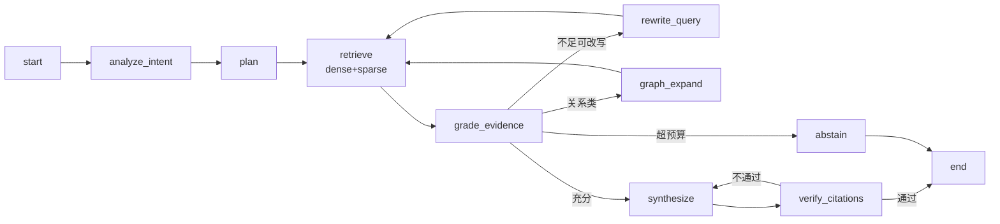
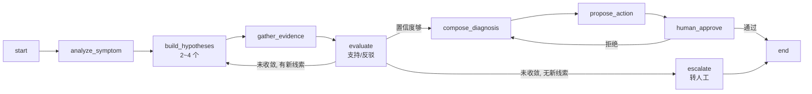

# 01 总体设计

## 1. 设计原则

1. **内核与域分离。** 运行时不知道"知识"和"履约"是什么，域通过配置注入工具、数据源、停止条件、护栏。
   判断标准：新增第三个域时，`runtime/` 不应改一行代码。
2. **权限在检索之前，不在检索之后。** 任何"先召回再过滤"的实现都视为缺陷——过滤后召回数量不可控，
   且中间态已泄漏到日志与缓存。
3. **域之间走协议，不走函数调用。** 域边界即服务边界，跨域用 A2A，这样故障隔离与独立演进才成立。
4. **可评测优先于可炫技。** 每加一个机制，必须能在评测集上给出增益或明确证伪。
5. **窄链路先行。** 知识域先做"一份文档 → 一个问题 → 一个带引用的答案 → 一个不越权的证明"；
   排障域先做"一个订单号 → 一个根因 → 一条证据链"。
6. **一切可回放。** 每次请求有 trace_id，能从最终结论倒推到证据、工具入参出参、模型与 token。

---

## 2. 分层视图

```
接入层   业务前端 / 内部系统（HTTP + SSE）
   │
业务层   Java 服务：鉴权、会话、配额、审计、审批、Agent 网关（REST/SSE）
   │
域层     Domain Pack：knowledge（检索图）/ fulfillment（诊断图）
   │
内核层   Runtime：图模板、工具注册表、记忆、护栏、观测、评测适配器
   │
能力层   解析 / 混合检索 / 图谱 / rerank / SQL / 日志检索
   │
存储层   PostgreSQL / Neo4j / MySQL / 业务库(只读) / MinIO / Redis
   │
观测层   OpenTelemetry → Langfuse + Prometheus + Grafana
```

**为什么网关不放在 Python 侧**：鉴权、审批状态、部门变更都是强事务业务逻辑，属于 Java 的舒适区。
Python 侧只接受"已授权主体 + 已收敛的 ACL 集合"，不自己查权限表——**权限逻辑只有一份实现**。

---

## 3. 双域抽象：Domain Pack

### 3.1 共享什么（Runtime，域无关）

| 能力 | 说明 |
|---|---|
| 图内核 | 状态机模板：`analyze → plan → act → observe → reflect → conclude`，节点可插拔 |
| 工具注册表 | 统一 schema 声明、参数校验、超时重试、幂等键、结果压缩、成本标注 |
| 记忆 | 工作记忆（checkpoint + 窗口 + 摘要压缩）、语义记忆（偏好抽取 + 向量化 + 遗忘）、情景记忆（历史成功案例）<br>详见 `07-记忆与会话设计.md` |
| 护栏 | 输入注入检测、输出脱敏、动作白名单、预算与步数硬限 |
| 观测 | OTel span 命名与属性规范、token/cost 计量、trace_id 跨进程透传（详见 `14-Span规范.md`） |
| 评测适配 | 统一 case 结构、指标插件接口、配置快照 |

### 3.2 差异什么（Domain Pack，配置化）

```yaml
# domains/knowledge/domain.yaml
name: knowledge
entry: api/main_knowledge.py
graph: knowledge_agentic_rag          # 图模板名
tools: [hybrid_retrieve, graph_query, doc_fetch]
memory: { working: true, semantic: true, episodic: false }
stop: { max_steps: 5, evidence_threshold: 0.75, budget_tokens: 12000 }
guard: { injection_check: true, action_whitelist: [] }
output: { schema: cited_answer }
eval: { datasets: [golden, unauthorized, injection, no_answer] }
```

```yaml
# domains/fulfillment/domain.yaml
name: fulfillment
entry: api/main_fulfillment.py
graph: fulfillment_diagnosis
tools: [lookup_order, query_metric, search_logs, check_rule, propose_action]
memory: { working: true, semantic: false, episodic: true }   # 情景记忆：相似历史工单
stop: { max_hypotheses: 4, max_steps: 12, confidence_threshold: 0.8 }
guard: { injection_check: false, action_whitelist: [propose_action] }
output: { schema: diagnosis_report }
eval: { datasets: [replay, action_safety] }
```

### 3.3 同一镜像两个入口

```
Dockerfile → 同一镜像
  ├─ knowledge   :8001  entrypoint: python -m api.main_knowledge
  └─ fulfillment :8002  entrypoint: python -m api.main_fulfillment
```

这样做的三个理由，面试可以直接讲：
1. **代码复用真实可量化**：Runtime + 评测 + 观测三块 100% 共享，约占代码量 60%~70%。
2. **部署仍独立**：知识域吃检索与嵌入，排障域吃工具调用与并发查询，资源画像完全不同。
3. **演进不互相拖累**：排障域要发版时不重启知识域。

### 3.4 抽象边界怎么验证

一个自检问题：**如果明天要加第三个域（比如"运营数据分析"），需要改什么？**
答案应该是：写一个 `domain.yaml` + 若干工具实现 + 一个图定义，`runtime/` 不动。
做不到，说明抽象漏了——这就是为什么值得做两个域，一个域根本测不出抽象是否成立。

---

## 4. 领域模型

### MySQL（Java 侧，业务真相）

```sql
kb_document
  id, title, file_key, mime, source_type, version, owner_id, owner_dept,
  acl_mode(static|dynamic|approval), status, parsed_at

kb_acl_grant              -- 三种来源统一建模
  id, doc_id, subject_type(user|dept|role), subject_id,
  action(read), source(static|dynamic|approval), rule_expr, expire_at

kb_approval               -- 审批产生的临时授权
  id, doc_id, applicant_id, approver_id, status, granted_at, expire_at

action_request            -- 排障域的动作审批
  id, trace_id, agent, action_type, params, risk_level,
  status(pending|approved|rejected|expired), approver_id, created_at
```

`action_request` 是排障域的关键设计：**Agent 不直接执行写操作，只产出待审批的动作**。
审批通过后才由 Java 侧调用真实接口，Agent 全程没有写权限。这是"安全"能讲出实质的地方。

### PostgreSQL（检索侧，读模型）

```sql
kb_chunk
  id, doc_id, parent_id, ord, content, section_path, page_no,
  token_len, acl_jsonb, tsv tsvector, embedding vector(1024)

kb_parent_chunk          -- small-to-big 的父块
  id, doc_id, content, section_path
```

- `acl_jsonb` 是**冗余的授权快照**，文档权限变更时由事件重建。写放大换来检索一条 SQL 搞定。
- `parent_id` 支撑父子块：子块（200~400 token）精准召回，父块（1000~1500 token）喂模型。
- `tsv` 由 `zhparser`/`pg_jieba` 生成，承担关键词召回那一路。

### Neo4j（图侧）

```
(:Entity {name, type, aliases})-[:REL {type, weight}]->(:Entity)
(:Entity)-[:MENTIONED_IN]->(:Chunk {id})
(:Community {id, level, summary})-[:HAS_MEMBER]->(:Entity)
```

`MENTIONED_IN` 是溯源链：图检索的结论必须能落回 chunk，再落回有权限的文档。

#### 图到底解决什么：向量检索的三个失效场景

图不是"更高级的检索"，是**补向量检索的三种结构性缺陷**。说不清这三种，就只是"我加了个图数据库"。

| 失效场景 | 例子 | 向量检索为什么不行 | 图怎么做 |
|---|---|---|---|
| **多跳关系** | "华东仓的负责人所在部门的审批人是谁" | 每段文字单独看都相关，但答案是**跨三份文档连出来的**，没有任何一个 chunk 包含完整答案 | 实体邻域 2~3 跳遍历 |
| **全局聚合** | "公司整体的报销流程分几层" | Top-K 召回必然只拿到局部片段，K 再大也覆盖不全，且模型看到的是零散条款 | 社区摘要（Leiden 分层，自底向上聚合） |
| **实体消歧** | "启明计划"在 5 份文档里指 5 个不同项目 | 向量只看语义相近，无法判断"这两个启明计划是不是同一个" | 别名归一 + 实体唯一节点 |

**图不替代向量，两者是并行两路，最后 RRF 融合**：

```
问题 ──┬── 向量 + BM25（PG）──── 命中片段，答案的文字依据在这
       └── 实体/关系/社区（Neo4j）─ 命中结构和全局视角，不含成文表述
                                    ↓
                        两路融合后，图结果必须经 MENTIONED_IN 回到 chunk
```

**为什么图结果一定要回到 chunk**：图里只有 `(A)-[:审批人]->(B)` 这样的关系，没有可以引用的成文表述。用户要的是"依据《XX 管理办法》第 3 章"，所以图只负责**找到该看哪里**，文字依据和引用仍由 chunk 提供。

#### 三个必须承认的限制

1. **建图贵**：实体抽取是 LLM 调用，成本约 3~5 倍于纯切块。所以**只对 20% 文档建图**（制度、流程、组织类；公告、通知不建），选型理由写在 `02-技术选型.md`。
2. **更新难**：文档改版要让旧关系失效。做法是关系带 `doc_version`，新版本入库时增量覆盖，旧关系降权而非立即删（避免误删他文档共用的实体）。
3. **权限不在图里**：图是**全局构建**的，实体和关系天然跨越所有文档。**权限只在查询时才有意义**——图检索出的每个 chunk 都必须过 ACL 过滤，`MENTIONED_IN` 就是这条过滤的必经之路。这是 `05-权限设计.md` 链路出口的第 4 项。

#### 什么时候不用图

| 情况 | 判断 |
|---|---|
| 问题几乎都是单跳事实 | 用图是浪费，向量 + BM25 足够 |
| 文档量 < 500 且关系稀疏 | 建图成本收不回，改 `doc_id` 关联表即可 |
| 只需要"找相似段落" | 这是向量检索的本职，不要引入图 |

**一句话**：图是为"答案不在任何一段文字里，而在文字之间的关系里"这类问题准备的。没有这类问题，就不要上图。

---

## 5. 关键流程

### 5.1 知识域：文档入库

```
上传 → Java 落 MinIO + kb_document(parsing) → 投递解析任务
     → Python：格式识别 → 按页路由解析(L0 直取 / Docling 主力 / MinerU 兜底) → 统一 IR
     → 语义分块 + 父子块 → 嵌入(BGE-M3 只取 dense；稀疏一路由 pg_search 的 BM25 承担)
     → 写 kb_chunk（带 ACL 快照）→ 抽取实体关系 → 图增量更新
     → 回写 status + parse_report
```

**解析质量指标必须量化**，否则后面所有效果问题都无法归因：
文本覆盖率、表格还原率、空块率、超长块率、乱码率。低分文档进人工复核队列。

### 5.2 知识域：问答

```
1. Java：鉴权 → 解析 SubjectContext（dept_paths / roles / approval_doc_ids / acl_epoch，Redis 缓存 300s + 事件失效）
   **不展开"可见文档清单"**——那会退回 1500 万条缓存的失效风暴（理由见 05 §2）
2. REST + SSE → Python：{query, subject_ctx, session_id, budget}
   （透传的是**主体属性 + 权限版本**，鉴权条件由 Python 拼进检索 SQL；这是**应用调 agent**，不是 A2A。
   字段与 SSE 事件协议见 `13-服务间契约.md`，契约文件是 `api/openapi.yaml`）
3. Supervisor 判意图：
     寒暄/闲聊 → 直答（省一次检索）
     事实/条款 → Agentic RAG
     流程/多跳 → Graph Agent（可回落）
     需要实时业务数据 → A2A 委派 fulfillment
4. 生成 + 引用校验 → SSE 流式（先吐引用骨架，再吐正文）
5. 异步：落 trace、token 计量、抽样进评测池
```

### 5.3 排障域：诊断

```
输入：订单号 / 异常码 / 自然语言描述
1. Java：校验调用方权限（哪类数据可见、哪些字段脱敏）
2. REST + SSE → fulfillment：{symptom, subject, scope, budget}
   （同样是应用调 agent。真正的 A2A 只发生在 knowledge ↔ fulfillment 之间）
3. analyze_symptom：结构化症状（订单、环节、现象、时间窗）
4. build_hypotheses：生成 2~4 个候选根因（带先验概率）
5. 每个假设：gather_evidence → 调工具（订单/指标/日志/规则）→ evaluate（支持/反驳）
6. 收敛：置信度 ≥ 阈值 → compose_diagnosis → propose_action → 人工审批 → 结束
   未收敛且未超预算 → refine_hypotheses
   超预算 → escalate（转人工，附已排除假设）
```

**注意这里没有"检索"这个词**——排障域的核心是假设树的深度优先搜索，
和知识域的广度优先检索是两种完全不同的控制流。这就是为什么"一个状态机模板"能共用，但"图定义"必须分开。

### 5.4 权限与审批变更

```
文档 ACL 变更 → Java 发 outbox 事件 → Python 消费 → 批量 update kb_chunk.acl_jsonb
                                        → **不清用户缓存**（缓存的是"我是谁"，不是"我能看什么"）
                                        → 但撤销类变更走同步路径（见 06 §4），保证"撤了就看不见"
                                        → 触发越权集回归（必跑）

动作审批 → Java 落 action_request(pending) → 审批人处理
        → approved：Java 调真实接口执行，回写结果
        → rejected：把拒绝原因回灌给 Agent，Agent 重新规划或终止
```

---

## 6. 知识域状态机（Agentic RAG）



| 节点 | 职责 | 约束 |
|---|---|---|
| analyze_intent | 判是否需要检索、问题类型 | 结构化输出，禁止自由文本 |
| plan | 拆子问题，定召回路数 | 最多 3 个子问题，防发散 |
| retrieve | 混合检索，权限条件下推 | top_k 20，父块回填 6 |
| grade_evidence | 逐条判相关 + 整体判充分 | 小模型打分控成本 |
| rewrite_query | 改写/扩展 | 最多 2 轮，带历史防重复 |
| graph_expand | 实体邻域扩展 | 跳数 ≤ 2，必须带 chunk 溯源 |
| synthesize | 生成带引用答案 | 引用格式强约束，无票不答 |
| verify_citations | 核对引用是否支撑论断 | 不通过重生成，最多 1 次 |
| abstain | 证据不足拒答 | 拒答率是被评测指标，不是失败 |

**停止条件**：证据充分性 ≥ 阈值 / steps ≥ 5 / tokens ≥ budget，三者取先到。

---

## 7. 排障域状态机（假设验证）



| 节点 | 职责 | 关键设计 |
|---|---|---|
| analyze_symptom | 把自由描述结构化成（订单、环节、现象、时间窗） | 缺字段时主动追问，而不是猜 |
| build_hypotheses | 生成候选根因 + 先验 | 情景记忆检索相似历史工单做先验，这是 memory 的真实用法 |
| gather_evidence | 按假设选工具取证 | 工具选择由假设驱动，不是全量轮询 |
| evaluate | 判定支持/反驳/无关 | 允许"证伪"，不是只为确认 |
| propose_action | 产出结构化动作（不执行） | 写操作永远走审批 |
| human_approve | 中断 + 恢复 | LangGraph interrupt 的实战落点 |

**这张图是 planning + tool calling + memory + HITL 的集中体现**，
比在知识域里硬凑一个"多智能体"更有说服力。

---

## 8. 框架能力四件套的落点

| 能力 | 知识域 | 排障域 | 共同取舍 |
|---|---|---|---|
| Planning | 意图 → 子问题计划（广度） | 假设树（深度，允许证伪） | 简单任务不套计划，全程计划是过度设计 |
| Tool calling | 检索、图谱查询 | 订单/指标/日志/规则/动作 | 注册表统一 schema、超时、幂等、结果压缩 |
| Memory | 工作记忆 + 语义记忆（用户偏好） | 工作记忆 + **情景记忆（历史工单）** | 长期记忆异步写、抽稀写，避免污染检索；三层分工见 `07-记忆与会话设计.md` |
| Multi-agent | Supervisor + handoff 到子 agent | 与知识域 A2A 协作 | 工具集差异大、上下文需隔离才拆；拆的代价是延迟翻倍 |

> 记忆的双域对照是加分项：知识域的长期记忆是"用户偏好"，排障域的情景记忆是"相似工单"。
> 同一个 Memory 子系统，两种用法——这比单域讲"我做了 memory"具体得多。

---

## 9. A2A 设计

### 9.1 先划清四层边界（最容易混的地方）

这四条经常被混为一谈，越混越显得不专业：

| 机制 | 方向 | 解决什么 | 本项目用在哪 |
|---|---|---|---|
| **函数调用** | agent → 代码 | 同一进程内确定性调用 | 图节点内部逻辑 |
| **MCP** | agent → 工具/数据 | 工具接入标准化 | 检索、查库、日志、规则引擎 |
| **REST/SSE** | 应用 → agent | 业务系统调 agent | Java 网关 → 任一 agent |
| **A2A** | agent ↔ agent | **对等委派、跨边界协作** | knowledge ↔ fulfillment |

一句话：**MCP 是纵向的（agent 向下够工具），A2A 是横向的（agent 向旁边够 agent），而"业务系统调 agent"两者都不是。**

`J -->|A2A| K` 是错的：Java 侧没有 Agent Card、没有 Task 状态机、不是自主决策体，它是**应用**（Application），不是 Agent。这一段必须是普通 REST + SSE。把应用调 agent 说成 A2A，是最常见的概念混淆，面试官一问"你 Java 服务的 Agent Card 长什么样"就穿帮。

### 9.2 本项目真正的 A2A 只有一处

```
knowledge-agent  ──A2A──▶  fulfillment-agent
   （入口 A）                  （入口 B）
```

| 项 | 内容 |
|---|---|
| 暴露方 Agent Card | `/.well-known/agent-card.json` |
| skills | `diagnose_order_symptom`（订单履约诊断） |
| 输入 | `{symptom, subject, scope, budget}` |
| 输出 Artifact | `part[]`：`data`（订单/指标结构化结果）+ `text`（根因结论） |
| 状态机 | `TASK_STATE_SUBMITTED → WORKING → (INPUT_REQUIRED) → COMPLETED / FAILED / CANCELED` |
| binding | JSON-RPC 2.0 over HTTP（v1.0 三选一：JSON-RPC / gRPC / HTTP+JSON） |
| 流式 | SSE，边诊断边推进 progress |

**注意 v1.0 的破坏性变更**（写代码时踩过的坑）：`Part` 不再有 `kind` 字段，改由携带的字段自我标识（`text` / `url` / `raw` / `data`）；枚举改为 `TASK_STATE_COMPLETED` 这种全大写；操作名改为 `SendMessage` / `GetTask`；HTTP 路径去掉 `/v1` 前缀。照 v0.3 的样例抄会直接跑不通。

### 9.3 为什么用它——但只承认成立的那部分

先说实话：**K 和 F 是同一套 Runtime、同一个镜像、同一个团队维护的。按业界最严的标准，这一条不满足"跨你不拥有的边界"，理论上用 LangGraph 子图就够。**

所以支撑 A2A 的不是"它们是两个 agent"这种弱理由，而是下面三条里**能被验证**的部分：

1. **状态边界（最强的一条）**：诊断是长时任务（单次 30s、多步工具调用），中途可能需要人补充信息（`input-required`）。这需要**可回放的 Task 状态机 + 中断续跑**，而不是一次请求-响应。REST 做这个要自己发明一套状态协议，A2A 直接给了。
2. **故障与资源边界**：排障域吃工具调用、知识域吃检索，资源画像完全不同，必须独立扩缩容；排障域挂掉时知识域要降级为"仅文档答案 + 数据不可得"，而不是陪葬。**降级策略需要一个明确的契约才能写**。
3. **演进边界**：Agent Card 是接口契约，`skills` 和 schema 变更要升版本。这逼着我把两个域的耦合面收敛到一个小 schema 上——**这是 A2A 带来的真实约束价值，跟协议本身无关，跟"有契约"有关**。

**不成立、不要硬讲的那条**：组织边界。这是我一个人写的项目，不装成两个团队。

### 9.4 什么时候不该用 A2A（主动说，比被问出来好）

| 场景 | 该用什么 | 理由 |
|---|---|---|
| 同进程内协作 | 函数调用 / 子图 | 加一次 HTTP 只增加延迟和故障面 |
| 同团队、同栈、同集群 | LangGraph 多智能体编排 | 编排框架更轻，还能共享状态 |
| 只是取一段数据 | MCP 或 REST | 对方没有自主决策，不构成 agent |
| 需要严格事务一致 | 别跨 agent | 分布式事务的代价远大于解耦收益 |

判断规则一句话：**只有当"对方是不透明、自主、可能跨组织，且任务有状态、可中断、要回放"三者同时成立，A2A 才划算。**

### 9.5 交互示例

> 用户问「华东仓昨天那批延误的订单，按新赔付政策该怎么处理」
> 1. knowledge 拆成两段：政策条款（自己走 RAG）+ 订单事实（委派）
> 2. A2A 发 Task 给 fulfillment，对方走诊断图，返回 Artifact（订单列表 + 根因）
> 3. knowledge 合并证据生成答案，引用同时标注**文档来源**与**业务数据来源**
>
> 若 fulfillment 不可用 → 降级为"政策部分可答，订单数据暂不可得"，并显式告知用户，不编造。

**权限上的一条硬约束**：委派必须携带最小 `scope`，**被调方按自己的权限模型二次校验，绝不继承调用方权限**（见 `05-权限设计.md` 第 6 节出口 6）。

---

## 10. 非功能性设计

| 维度 | 知识域 | 排障域 |
|---|---|---|
| 延迟 | 首 token < 1.5s，P95 < 4s | 单次诊断 < 30s（多步工具调用） |
| 成本 | 意图直答省检索；grade 用小模型；语义缓存 | 工具结果压缩；假设数上限 4 |
| 降级 | Agent 挂 → 返回检索结果列表 | 工具超时 → 返回已得证据 + 部分结论 |
| 安全 | 越权零容忍、注入检测 | 写操作零直通、字段级脱敏 |
| 审计 | 谁问的、看了哪些文档、引用了哪些 | 谁触发、调了哪些工具、建议了什么动作、谁审批 |
