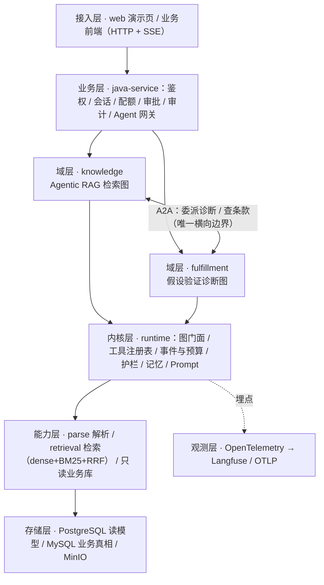
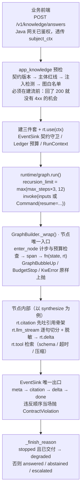
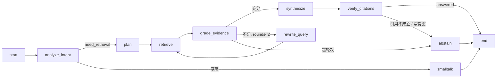
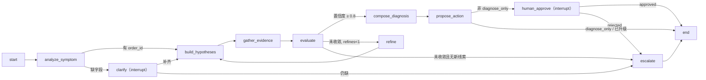

# 17 架构总览与代码地图

## 0. 本文定位

`01-总体设计.md` 回答"为什么这么设计"，本文回答**"东西在哪、怎么串起来、哪些是自研的"**。

三件事必须做到，否则本文没有存在价值：

1. **代码树与磁盘一致**。树是从仓库真实扫出来的，不是凭记忆画的；新增目录时本文要跟着改。
2. **说清手写边界**。哪部分是自研、哪部分是 LangGraph、哪部分是第三方库，逐项列明，避免"我手写了一个 Agent 框架"这种一追问就穿帮的说法。
3. **标出文档与代码的偏差**。已经写了但没接上的能力单独列一节，别让读者以为它存在。

配套阅读：`01`（设计原则与状态机）、`13-服务间契约.md`（SSE 字段）、`14-Span规范.md`（埋点）、
`18-架构分层与协作链路-细化视图.md`（同一套分层拆到子组件级，含 Mermaid 图与线型语义）。

---

## 1. 一句话架构

> **Runtime 只提供"节点"这个可观测执行单元（span + 预算 + 事件出口），控制流完全交给 Domain Pack，契约层保证外部看到的行为不被随口改动。**

判断抽象是否成立的唯一自检题：**新增第三个域需要改什么？**
答案必须是"一个 `domain.yaml` + 若干工具 + 一个图定义，`runtime/` 不动"。
这条不靠自觉，靠 `tests/test_domain_isolation.py` 扫 `runtime/` 源码，出现域名即失败。

---

## 2. 分层视图



**纵向是依赖，横向只有一条且是双向的**：域之间走 A2A，其余全部是"上层调下层"。
双向的代价是"A→B→A 可能成环"，所以协议层强制带 `scope.chain`，服务端见到链里有自己就拒——
这是双向能成立的前提，不是可选加固。
`_debug/trace/{trace_id}` 是本地查看 span 树的调试入口，不依赖 collector。

**为什么网关不放 Python 侧**：鉴权、审批状态、部门变更都是强事务业务逻辑，属于 Java 的舒适区。
Python 只接受"已授权主体 + 已收敛的属性集合"，不自己查权限表——**权限逻辑只有一份实现**。

---

## 3. 代码树（核心部分）

> 省略 `.venv/`、`.git/`、`__pycache__/`、`target/`、`recordings/`、语料与评测产物。
> 标 `★` 的是阅读入口，标 `⚠` 的是"文档写了但未接上"（见 §8）。

```
knowops-agent/
├── README.md                          项目说明与快速开始
├── Makefile                           常用命令（run/eval/test/ingest）
├── requirements.txt                   Python 依赖（唯一重依赖 = langgraph）
├── api/openapi.yaml                   ★ 服务间契约的唯一真相源
├── config/
│   ├── models.yaml                    角色→provider/model 映射 + 计价表
│   ├── parse.yaml                     解析引擎路由配置
│   └── prompts.yaml                   Prompt 全局配置
│
├── deploy/
│   ├── docker-compose.yml             PG / Java / 两域服务编排
│   ├── init/01_schema.sql             读模型 + checkpoint + memory 表
│   ├── init/02_seed_m0.sql            演示种子数据
│   ├── init/03_pg_search_index.sql    pg_search 中文分词索引
│   ├── init/04_ops_schema.sql         履约域业务表
│   ├── smoke/01_acl_smoke.sql         越权回归用例
│   ├── corpus-v2/                     48 份评测语料（HR/FIN/PUR/WMS/OMS/IT/CS）
│   └── sample-corpus/                 M0 最小语料
│
├── java-service/                      ★ 业务网关（Spring Boot，49 个 Java 文件）
│   ├── contract/                      OpenAPI 生成 DTO + 接口
│   │   ├── api/{V1Api, HealthzApi, ReadyzApi, ApiUtil}.java
│   │   └── dto/{AnswerRequest, Task, MetaEvent, DeltaEvent, CitationEvent,
│   │            DoneEvent, Error, ActionProposal, SubjectContext, ...}.java
│   └── app/
│       ├── web/{KnowledgeGatewayController, FulfillmentGatewayController,
│       │        UploadController, SubjectController, HealthController}.java
│       ├── gateway/{AgentGateway, WebClientAgentGateway}.java   REST+SSE 转发
│       ├── acl/{SubjectResolver, InMemorySubjectResolver}.java  主体解析
│       └── upload/LocalUploadService.java
│
├── agent-service/                     ★ Agent 侧（Python）
│   ├── runtime/                       ★★ 自研内核（3110 行，见 §5）
│   │   ├── __init__.py                Runtime 装配 / ContextVar / build_runtime
│   │   ├── graph.py                   StateGraph 门面 + 节点包装（span/预算）
│   │   ├── events.py                  ★ Ledger 预算账本 + EventSink 契约守卫
│   │   ├── registry.py                工具注册表（schema/超时/压缩）
│   │   ├── guard.py                   注入 / 脱敏 / 动作白名单
│   │   ├── memory.py                  工作 / 语义 / 情景记忆（M0 内存实现）
│   │   ├── llm.py                     OpenAI 兼容直连 + 重试 + 尾帧 usage
│   │   ├── prompts.py                 Prompt 库 + 模板/渲染双 sha
│   │   ├── tracing.py                 OTel 薄封装 + span_tree 自检
│   │   ├── config.py                  domain.yaml 强类型加载
│   │   ├── errors.py                  KwError / BudgetStop / ContractViolation
│   │   └── sqlguard.py                只读 SQL 白名单校验
│   │
│   ├── domains/                       ★★ 域层（唯一的业务语义所在地）
│   │   ├── knowledge/
│   │   │   ├── domain.yaml            工具集 / 阈值 / 护栏 / 记忆开关
│   │   │   ├── graph.py               ★ Agentic RAG 状态机
│   │   │   ├── graph_pipeline.py      ★ 单遍基线（与 agentic 对照）
│   │   │   ├── nodes.py               9 个节点实现（含流式切分与引用净化）
│   │   │   ├── tools.py               hybrid_retrieve / doc_fetch
│   │   │   └── delegate.py            A2A 委派节点（仅 pipeline 图引用）
│   │   └── fulfillment/
│   │       ├── domain.yaml
│   │       ├── graph.py               ★ 假设验证状态机
│   │       ├── nodes.py               10 个节点（含 clarify / human_approve 中断点）
│   │       └── tools.py               订单/库存/物流/支付/日志/规则/动作 + ask_knowledge（A2A）
│   │
│   ├── api/                           ★ 接入层
│   │   ├── app_knowledge.py           知识域入口（无状态，一请求一流）
│   │   ├── app_fulfillment.py         排障域入口（有 Task 状态机）
│   │   ├── main_knowledge.py          启动入口 :8001
│   │   ├── main_fulfillment.py        启动入口 :8002
│   │   ├── sse.py                     SSE 帧编码 + Channel 回压
│   │   ├── replay.py                  幂等键 + 整条流重放
│   │   └── schemas.py                 ★ 事件与请求的 Pydantic 模型
│   │
│   ├── retrieval/                     ★ 能力层：检索
│   │   ├── pg_retriever.py            ★ dense+BM25 双路 + RRF，ACL 下推同一条 SQL
│   │   ├── pg_ingest.py               写入 kb_chunk（带 ACL 快照）
│   │   ├── embed.py                   BGE-M3 dense 向量
│   │   ├── rerank.py                  精排（可选，缺省关闭）
│   │   ├── memory_retriever.py        无 PG 时的内存回落
│   │   ├── base.py                    Evidence 数据结构
│   │   └── dsn.py                     连接串解析
│   │
│   ├── parse/                         能力层：文档解析
│   │   ├── pipeline.py                解析主流程
│   │   ├── router.py                  按页路由引擎
│   │   ├── engines.py                 L0 直取 / Docling / MinerU
│   │   ├── ir.py                      统一中间表示
│   │   ├── chunker.py                 语义分块 + 父子块
│   │   └── config.py / clean.py
│   │
│   ├── a2a/                           ★ 跨域协议（唯一横向边界，双向）
│   │   ├── client.py                  send_message 通用 / delegate_diagnosis / ask_knowledge
│   │   ├── server.py                  Agent Card + JSON-RPC（含回环门禁）
│   │   └── types.py                   Part / Task / TaskState + 委派链（chain / may_delegate）
│   │
│   ├── prompts/
│   │   ├── manifest.yaml              ★ Prompt 登记表（缺登记启动即失败）
│   │   ├── knowledge/*.md             9 个（analyze_intent / plan / grade / rewrite /
│   │   │                              synthesize / synthesize_cite / smalltalk ...）
│   │   └── fulfillment/*.md           4 个（analyze_symptom / build_hypotheses /
│   │                                  evaluate / compose_diagnosis）
│   │
│   └── tests/                         ★★ 约束的可执行证明（25 个测试文件）
│       ├── test_domain_isolation.py   runtime/ 里出现域名即失败
│       ├── test_event_order.py        契约顺序不变量
│       ├── test_task_resume.py        interrupt / resume 不重复执行
│       ├── test_finish_reason.py      交付过的不能判 abstained
│       ├── test_guard.py              注入 / 脱敏 / 动作白名单
│       ├── test_pg_retriever.py       ACL 下推与降级链
│       ├── test_stream_answer.py      流式切分与引用标记完整性
│       └── test_third_domain.py       第三个域能否零改内核接入
│
├── scripts/                           运维与评测脚本
│   ├── kw.py                          本地一键入口
│   ├── ingest_pg.py                   语料入库
│   ├── eval_run.py / eval_compare.py  端到端跑批与对比
│   ├── eval_ops.py                    排障域回放评测
│   ├── smoke_m0.py                    冒烟
│   ├── verify_pg.py / verify_parse.py 存储与解析体检
│   └── probe_relevance.py             相关性下限探测
│
├── eval/                              跑批报告与对照表（report-v2 / table-m1 ...）
├── web/                               演示页（index.html + app.js + styles.css）
└── docs/                              设计文档 01–17 + adr/0001–0003
```

---

## 4. 一次请求的协作链路

以知识域问答为例（排障域仅在 §4.2 的差异处说明）。



三处不能省的细节：

- **幂等键命中直接重放整条流（含 meta）**，不是只重放 `done`。客户端可能整条流都丢了，重放整条才能保证 id 单调性与首次一致，前端逻辑不用分叉。
- **流式切点**：优先句子边界；无边界但已够长、括号配平且不含数字 / `@` 才放行。脱敏是按模式匹配的，号码被切成两段就两段都匹配不上——宁可慢，不可漏。
- **`interrupt` 靠异常实现**，所以 `_wrap` 的 `except` 必须把 `GraphBubbleUp` 原样上抛；否则中断会被当成普通异常吞掉，`human_approve` 直接失效。

### 4.1 为什么是"三个唯一入口"

| 入口                           | 唯一性由谁保证                       | 绕过后的后果                          |
| ------------------------------ | ------------------------------------ | ------------------------------------- |
| 节点只能走 `builder.node()`  | `GraphBuilder` 不暴露 `add_node` | 某节点忘埋 span，trace 断链，归因失效 |
| 工具只能走 `registry.call()` | 工具实现不接受 subject 参数          | 权限从参数泄漏、提示注入可改权限      |
| 事件只能走 `sink.*`          | `EventSink` 内部状态机             | 客户端永久挂起、引用编号错位          |

三处都是**把"纪律"翻译成"结构"**：不是要求实现者记得做，而是让他做不到不做。

### 4.2 排障域的差异

| 维度     | knowledge                          | fulfillment                                         |
| -------- | ---------------------------------- | --------------------------------------------------- |
| 请求形态 | 无状态，一请求一条流               | 有 Task 状态机，支持 GET / resume / cancel          |
| 长度     | 首 token < 1.5s，P95 < 4s          | 单次诊断 < 30s，多步工具调用                        |
| 中断     | 无                                 | `clarify` / `human_approve` 两个 interrupt 节点 |
| 超预算   | `on_budget: abstain`（拒答）     | `on_budget: escalate`（转人工，绝不猜）           |
| 记忆     | 工作记忆（+ 语义记忆声明，见 §8） | 工作记忆 + 情景记忆（历史成功工单）                 |
| 写操作   | 无                                 | 只 `propose_action`，执行永远走 Java 审批         |

**resume 的关键细节**：`graph.py` 用 `Command(resume=...)`，不是重发 inputs。后者会从头跑图，工具重复调用、重复计费，假设树也变了。

---

## 5. Runtime 内核：手写边界（重要）

**结论先说：不是完全手写。运行时约束层是自研的，编排引擎是 LangGraph。**

### 5.1 代码量分布（`runtime/` 共 3110 行）

| 类别     | 文件                                                                                                                                    | 行数  | 性质                                              |
| -------- | --------------------------------------------------------------------------------------------------------------------------------------- | ----- | ------------------------------------------------- |
| 完全自研 | `events.py` 374、`registry.py` 250、`guard.py` 108、`memory.py` 145、`config.py` 225、`prompts.py` 243、`sqlguard.py` 264 | ~1609 | 契约、预算、工具治理、护栏、记忆纪律、Prompt 指纹 |
| 薄封装   | `llm.py` 501、`tracing.py` 252                                                                                                      | ~753  | 直接 httpx 打 OpenAI 兼容协议；直接 OTel SDK      |
| 门面     | `graph.py` 193                                                                                                                        | 193   | 只是 StateGraph 的转手 + 节点包装                 |
| 装配     | `__init__.py` 461、`errors.py` 94                                                                                                   | 555   | Runtime 组装、ContextVar、错误分类                |

### 5.2 LangGraph 的全部使用面（7 处 import）

```
runtime/graph.py       StateGraph / START / END / Command / GraphBubbleUp
runtime/__init__.py    InMemorySaver / PostgresSaver
domains/fulfillment/nodes.py   interrupt
```

**项目里没有一行 langchain**：没有 agent executor、没有 chain、没有 vector store 封装。检索是自己写的 SQL，Prompt 是自己写的模板库。

### 5.3 所以"手写"手写的是什么

手写的是 LangGraph **不提供**、且最容易出事故的那部分：

- **契约层**（`events.py`）：`citation` 不得晚于 `delta`、`eid` 必须发出过、`done`/`error` 只能有一个、`close()` 没终止事件直接抛。
- **预算层**（`Ledger`）：步数 / token / 成本 / 截止时间四者任一超限，在**节点边界**硬停，而不是节点跑到一半。
- **工具治理**（`registry.py`）：schema 校验、线程池超时、`copy_context` 复制、超过 1500 字符立即压缩。
- **权限与脱敏**（`guard.py` + `pg_retriever.py` 的 `permitted` CTE）：鉴权条件与检索排序同一条 SQL。
- **不可静默降级**：`DegradedEnum` 唯一入口；`build_provider` 在 online 缺 key 时宁可起不来，也不回落 mock。

### 5.4 这条边界为什么合理

**执行引擎不自研**：状态合并、条件边调度、checkpoint、interrupt/resume 自研会陷进去，收益为零。
**约束层必须自研**：框架不会替你保证契约顺序、预算硬停、越权零容忍。

一句话口径：**不是手写 Agent 框架，是手写了框架外面的那层约束。** 若被追问"Runtime 做了什么"，答案要落在 `events.py` 和 `registry.py`，不要落在 `graph.py`——后者只有 193 行门面，一追问就露。

---

## 6. Domain Pack：配置即差异

两个域共用同一镜像、同一 Runtime，差异全部落在这两个文件里。

| 配置项             | knowledge                               | fulfillment                                          |
| ------------------ | --------------------------------------- | ---------------------------------------------------- |
| `graph`          | `knowledge_agentic_rag`               | `fulfillment_diagnosis`                            |
| `tools`          | `hybrid_retrieve, doc_fetch`          | 订单/库存/物流/支付/日志/指标/规则/动作 + `ask_knowledge`（9 个） |
| `memory`         | working + semantic                      | working + episodic                                   |
| `stop.max_steps` | 10（改写回环实际 3 步，留 1 步余量）    | 12（正常诊断 7 步，含审批中断点）                    |
| `stop` 阈值      | `evidence_threshold: 0.75`            | `confidence_threshold: 0.8`、`max_hypotheses: 4` |
| `stop.on_budget` | `abstain`                             | `escalate`                                         |
| `guard`          | `injection_check: true`，动作白名单空 | `injection_check: false`，白名单 2 个 / 红线 3 个  |
| `output.schema`  | `cited_answer`                        | `diagnosis_report`                                 |

**启动期强校验**（`config.py`）：`domain.yaml` 的 `graph` 必须等于图模块的 `NAME`，`tools` 必须全部已注册，`prompts` 必须全部能加载。任一不符直接起不来——这些错误拖到运行期就是"跑的不是你以为的图"。

两个容易写错的点：

- `action_whitelist` 写的是**动作类型**（`retry_push_carrier`），不是工具名（`propose_action`）。写错等于白名单永远不生效，是个静默失效的安全配置。
- `max_steps=10` 不是拍脑袋：改写回环是 `rewrite → retrieve → grade` **三步**，卡到 8 会让最后一步 `verify` 撞预算，表现为"答案生成对了却标成 abstained"。

---

## 7. 两张图的设计

同一个 `GraphBuilder`，两套完全相反的边。

### 7.1 知识域：广度检索 + 早停



三处刻意的设计：

- **`abstain` 单独成节点**：拒答是正常路径，不是 `return {}` 的兜底。单独成节点才能在 trace 里区分"这轮拒答"与"这轮失败"。
- **`retrieve` 保留上一轮证据**：改写是为了补证据，不是抹掉已有证据。早先这里是整体覆盖，结果上一轮的正确证据没了、模型却还记得它的 eid → 引用校验失败 → 正确答案被判拒答。
- **改写不出兜底查询**：模型没给出可用改写就原样再检一轮然后拒答。曾经兜底成"原查询 + 制度规定"，而"制度"几乎出现在每份制度文档里，等于把噪声硬塞进第二轮证据。

### 7.2 排障域：深度假设 + 允许证伪



四个关键点：

- **`refine` 单独成节点，只做 `refines += 1`**。路由必须是纯函数，否则同一份 state 两次路由可能给出不同结果，trace 无法复现。
- **`human_approve` 只做 interrupt**，不调模型、不调工具。resume 会从头重放节点，业务逻辑混进来就会重复调用、重复计费。
- **审批被拒走 `escalate`，不回 `compose_diagnosis`**。证据没变时重写报告只是换个说法，没有信息增益。
- **`diagnose_only` 放在 State 而不是域配置**：同一个域要支持两种入口（直接调用 / A2A 委派），"要不要走审批"取决于这次请求的用途，不是域的能力。

### 7.3 两个域的图必须分开的理由

知识域是**广度优先 + 早停**（检索 → 判定 → 补检索 → 收敛）；
排障域是**深度优先 + 允许证伪**（生成假设 → 逐条取证 → 支持/反驳 → 收敛或转人工）。

内核不知道"检索"和"假设树"的区别，这正是 §1 那道自检题要证明的东西。

---

## 8. 文档与代码的三处偏差（必须知道）

这三处不影响主链路成立，但被追问时最容易穿帮。

| 项       | 文档口径                                                | 代码现状                                                          | 建议                                                |
| -------- | ------------------------------------------------------- | ----------------------------------------------------------------- | --------------------------------------------------- |
| 语义记忆 | `knowledge` 的 `memory.semantic: true`              | `nodes.py` 里没有 `rt.recall("semantic")`，只有接口没有消费者 | 补一个"用户偏好"读取点，或把开关改成 false          |
| 图谱扩展 | `01 §6` 有 `graph_expand` 节点，Neo4j 作并行第三路 | agentic 图无该节点；检索只有 dense + BM25 + RRF                   | 要么补实现，要么在文档标注 M1 范围                  |
| A2A 委派 | 双向：知识域⇄排障域                                           | 通道双向已通（两侧都挂 Agent Card + `/a2a`），但知识域 → 排障域的 `maybe_delegate` 仍只挂在 `graph_pipeline`，agentic 主图未接；排障域 → 知识域已作为 `ask_knowledge` 工具接入取证 | 明确"仅 pipeline 图启用"，或在主图 grade 之后加分支 |

另外两条口径要说准：

- **情景记忆**只存成功案例（`success=False` 直接丢弃），且按域隔离而非按用户——按用户切分会让同一个工单库被切成 N 份，相似案例永远召不回来。
- **M0 的记忆召回是词面重合打分，不是向量**。不要描述成"语义记忆向量检索"。

---

## 9. 五条不变量（可直接当验收标准）

| # | 不变量         | 落点                                             | 违反的后果                                  |
| - | -------------- | ------------------------------------------------ | ------------------------------------------- |
| 1 | 权限在检索之前 | `permitted` CTE 与排序同一条 SQL               | 过滤后召回数量不可控，中间态泄漏到日志/缓存 |
| 2 | 引用先于正文   | `sink.citation` 检查 `_delta_started`        | 前端已渲染正文，引用编号必然错位            |
| 3 | 终止事件唯一   | `sink.done/error/_terminal_once` + `close()` | 客户端永久挂起                              |
| 4 | 预算在节点边界 | `Ledger.enter_node()`                          | 节点跑到一半停，留下不可解释的半截状态      |
| 5 | 域隔离         | `test_domain_isolation.py` 扫源码              | 抽象漏了，补文档没用                        |

补充一条**交付语义**：正文一旦流式发出就不可撤回。此时再判 `abstained`，等于"API 说没答、用户屏幕上摆着完整答案"，下游还会据此转人工。所以已交付的只能标 `degraded`——`sink.delivered` 就是为这条存在的。

---

## 10. 常见追问口径

**Q：这套 Runtime 是自研的吗？**
A：编排引擎是 LangGraph（状态机、checkpoint、interrupt/resume），运行时约束层是自研的——契约顺序、预算硬停、工具治理、权限下推。LangGraph 只出现在 7 处 import，没有 langchain。

**Q：为什么只用两个域，不用一个？**
A：一个域测不出抽象是否成立。两个域的控制流相反（广度早停 vs 深度证伪），共用同一套 Runtime 还能都跑通，才证明"内核不知道业务"。

**Q：A2A 是不是过度设计？**
A：承认它理论上可以用子图替代（同一团队、同一镜像）。成立的是三条：诊断是长时任务需要可回放的 Task 状态机；两域资源画像不同必须独立扩缩容与降级；Agent Card 逼着把耦合面收敛到小 schema。不成立的那条（组织边界）不要硬讲。

**Q：双向 A2A 怎么防环？**
A：`scope.chain` 记录"已经参与过的域"，服务端在 handler 之前就拒。三道门禁：`types.may_delegate` 判跳数与回环、`client` 出站追加本域、`server` 入口拒绝。为什么必须在入口拒——放在 handler 里判，图已经跑了几步 LLM，拦下时 trace 和预算已经被污染了。跳数上限 2，因为第 3 跳没有新信息增益，只有成本。

**Q：为什么排障域查条款要走 A2A，不直接读文档库？**
A：文档可见性由静态共享/动态共享/审批单共同决定，那套判定在知识域。排障域直读只能读出一个"看起来更全"但越权的结果。走 A2A 的意义是**由有权限的一侧检索**，而不是绕过它。另外 `check_rule` 只给规则触发条件，给不了"用户签的那版条款原文"。

**Q：怎么证明"权限在检索前"而不是召回后过滤？**
A：`permitted` CTE 与 BM25/向量排序在同一条 SQL；ParadeDB 的 planner 会把 CTE 里的 acl 条件合并进索引扫描（EXPLAIN 里是 `heap_filter`），并且有 `smoke/01_acl_smoke.sql` 做越权回归。

**Q：图（GraphRAG）做了什么？**
A：**目前没做**。见 §8。文档里是设计口径（补多跳、全局聚合、实体消歧三种失效场景），代码只有 dense + BM25 + RRF。回答时要区分"设计"与"已实现"。

---

## 11. 关键文件索引

| 想改什么             | 先看哪个文件                                                                                 |
| -------------------- | -------------------------------------------------------------------------------------------- |
| 加一个节点           | `domains/<域>/nodes.py` + `graph.py` 的 `build()`                                      |
| 加一个工具           | `domains/<域>/tools.py` 的 `register()` + `domain.yaml` 的 `tools`                   |
| 调阈值 / 步数 / 预算 | `domains/<域>/domain.yaml` 的 `stop`                                                     |
| 改 Prompt            | `prompts/<域>/*.md` + `manifest.yaml` 登记（版本与 sha 会进 trace）                      |
| 改 SSE 事件字段      | `api/schemas.py` + `api/openapi.yaml` + Java 侧 `contract/dto`                         |
| 改检索 / ACL         | `retrieval/pg_retriever.py` 的 `_PERMITTED_SQL`                                          |
| 换模型               | `config/models.yaml`（临时对照用 `KW_ROLE_OVERRIDE`）                                    |
| 加一个域             | 新建 `domains/<新域>/`（`domain.yaml` + `graph.py` + `tools.py`），`runtime/` 不动 |

---

## 12. 变更记录

| 日期       | 变更                                                       |
| ---------- | ---------------------------------------------------------- |
| 2026-11-19 | 初版。基于当前代码快照整理分层、代码树、自研边界与偏差清单 |
