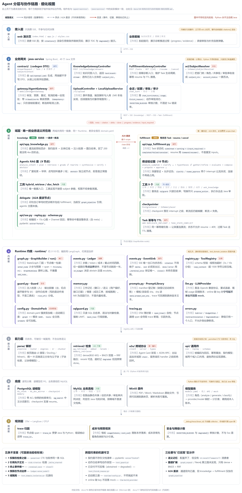
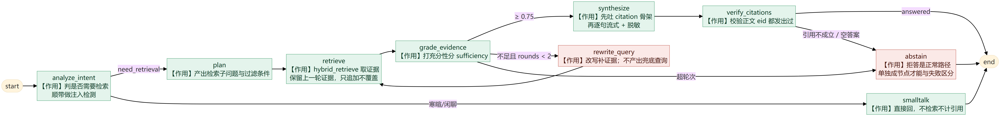
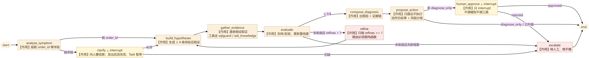
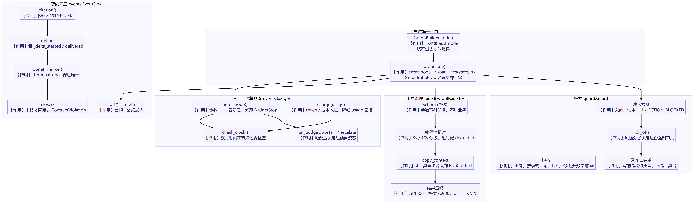
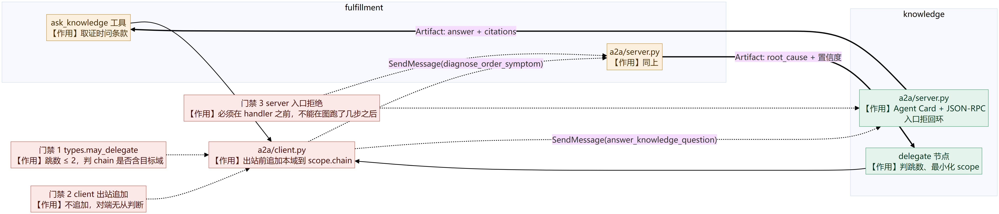
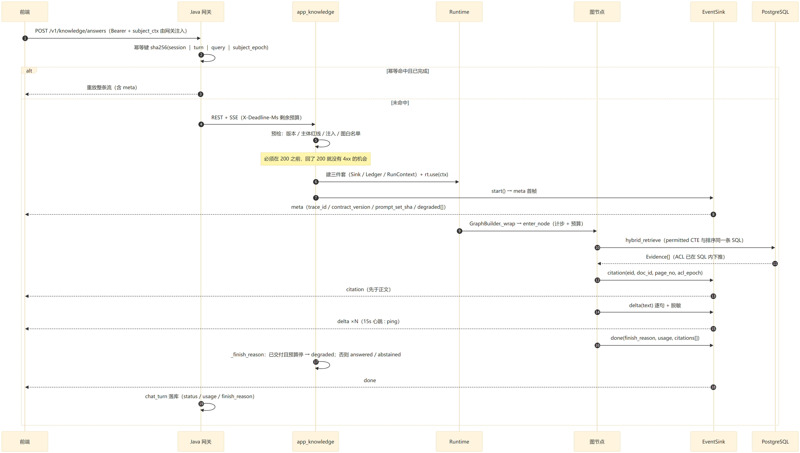

# 18 架构分层与协作链路（细化视图）

> 本文是 `17-架构总览与代码地图` 配套的**图**版本：17 回答"东西在哪"，本文回答"**谁调谁、数据怎么流、哪条线不能断**"。
> 原图只到"方框"粒度（如"护栏""事件与预算账本"），这里把每个方框拆到**子组件 + 一行作用说明**，
> 并对所有跨层边标注线型语义。组件名与 `agent-service/`、`java-service/` 中的实际类/模块一一对应。

---

## 0. 读法与图例

> 本文所有图均以**高分辨率图片**形式插入（`docs/diagrams/` 下），可直接点击放大查看细节。
> 下表的线型语义是**读图的图例**：图片里同类线型沿用同一含义，不再内嵌 Mermaid 源码。

### 0.1 线型语义（全文统一）

| 线型 | 图示 | 语义 | 典型例子 |
|---|---|---|---|
| 同步实线 | 实线箭头 → | 调用方阻塞等待；被调方返回结果或抛错 | Java → 域服务 REST；节点 → `registry.call()` |
| 异步/委派虚线 | 虚线双箭头 ⇢ | 发起后不共享调用栈；结果通过流或回调回来 | knowledge ⇄ fulfillment 的 A2A JSON-RPC |
| 回流箭头 | 红色箭头 ⇡ | 结果/证据/降级标记向上回传，不改变调用方向 | `done/error` 事件、`degraded[]`、Artifact 回传 |
| 依赖（读） | 浅灰虚线 | 只读依赖，不构成控制流 | 检索 → PG 读模型；Python → MySQL 只读 |

**一条硬规则**：图中**没有反向实线**。Python 侧永远不主动调 Java（`13 §1`），
唯一的横向边是 A2A 虚线，且必须带 `scope.chain`。

### 0.2 分层总览（一屏速读）

```
① 接入层   web 演示页 / 业务前端                 —— 只消费 SSE，不参与决策
② 网关层   java-service：鉴权/会话/配额/审批/审计  —— 权限的唯一计算点
③ 域层     knowledge(:8001 无状态) ⇄ fulfillment(:8002 有状态 Task)
④ 内核层   runtime/：图门面·账本·契约守卫·工具治理·护栏·记忆·Prompt  —— 域无关
⑤ 能力层   parse 解析 / retrieval 检索 / sqlguard 只读查询
⑥ 底座     PostgreSQL 读模型 · MySQL 业务真相 · MinIO · 模型 API
⑦ 观测     OTel → Langfuse / OTLP（+ _debug/trace 本地兜底）
```

---

## 1. 全景分层细化图



**这张图的三个读法**

1. **纵向看请求**：`L0 → L1 → L2 → L3 → L4 → L5`，每一层只认识下一层的接口，不认识下下层。
2. **横向看唯一例外**：`K ⇄ F` 是唯一横向边，虚线双向，且带 `scope.chain` 防环。
3. **看回流箭头**：所有向上回传都收敛到 `EventSink` 一个出口，再经网关转成 SSE 帧——**不存在第二套出口**。

---

## 2. 逐层拆解（组件 · 作用 · 上下游）

### 2.1 接入层

| 组件 | 作用 | 上游 | 下游 |
|---|---|---|---|
| `web/index.html + app.js + styles.css` | 演示页：提问、流式渲染、引用跳转、TOC、`degraded` 提示 | 人 | Java 网关 `:8080` |
| 业务前端 | 知识问答页（一问一答）与排障工单页（长任务 + 审批） | 人 | 同左 |

**约束**：前端**不解析编号**。正文里带的是 `eid` 占位符，编号由前端按 `citations[]` 顺序渲染（`13 §4.3-2`）。
原因：一旦把 `[1][2]` 写进流，压缩后就错位，引用是数据不是文本。

### 2.2 业务网关层（java-service）

| 组件 | 作用 | 上游 | 下游 |
|---|---|---|---|
| `contract/`（codegen DTO） | 契约的编译期绑定：`AnswerRequest` / `Task` / `MetaEvent` / `CitationEvent` / `DeltaEvent` / `DoneEvent` / `Error` / `ActionProposal` / `SubjectContext` | `api/openapi.yaml` | 所有 Controller |
| `KnowledgeGatewayController` | `POST /v1/knowledge/answers`，SSE 透传 | 前端 | `AgentGateway` → `:8001` |
| `FulfillmentGatewayController` | `POST /tasks`、`GET /tasks/{id}`、`/resume`、`/cancel`；Task 幂等与 TTL | 前端 / 审批人 | `AgentGateway` → `:8002` |
| `acl/SubjectResolver` | **权限的唯一计算点**：把部门树、角色、共享组、审批单收敛成 `subject_ctx` | 登录态 / 组织架构 | 请求体 |
| `gateway/AgentGateway`（`WebClient`） | 转发、预算、重试、取消的**唯一实现处** | Controller | 域服务 |
| `UploadController` + `LocalUploadService` | 上传、落盘、触发解析入库 | 管理端 | `parse/` + `ingest` |
| 会话/配额/审批/审计 | `chat_turn` 落库、动作审批待办、`INJECTION_BLOCKED` 单独计数 | `AgentGateway` 回流 | MySQL |

**为什么网关不放 Python 侧**：鉴权、审批状态、部门变更都是强事务业务逻辑，属于 Java。
Python 只接受"已授权主体 + 已收敛的属性集合"，**不自己查权限表**——权限逻辑只有一份实现。

**网关侧三条硬约束**

- `X-Deadline-Ms` 传**剩余**毫秒，不传绝对时间戳（跨机时钟漂移会造成"两台机器行为不同"的玄学 bug）。
- 重试**只在收到 `meta` 之前**，最多 2 次，退避 1s→4s 带抖动；一旦流出 `delta` 就不许重试。
- SSE 三个方法的返回句柄手写（`SseEmitter` / `Flux<ServerSentEvent>` 生成器推不出来），但**载荷 DTO 仍来自 codegen**——契约一致性保在载荷层，不保在传输句柄层。

### 2.3 域层 · knowledge（Agentic RAG 检索图）

| 组件 | 作用 | 上游 | 下游 |
|---|---|---|---|
| `api/app_knowledge.py` | 预检四步 + 三件套装配 + 建流 | 网关 | `runtime` / 图 |
| `api/sse.py` | `id/event/data` 帧编码、15s 心跳、`Channel` 回压 | `EventSink` | 网关 |
| `api/replay.py` | 幂等键 `sha256(session｜turn｜query｜subject_epoch)`，命中**重放整条流（含 meta）** | 网关 | 内存/缓存 |
| `api/schemas.py` | pydantic v2，`extra="forbid"` | codegen | 全链路 |
| `domains/knowledge/graph.py` | 9 节点状态机 + 3 个路由函数（纯函数） | `build_runtime` | `nodes.py` |
| `domains/knowledge/nodes.py` | 节点实现（含流式切分、引用净化） | `graph` | `rt.*` |
| `domains/knowledge/tools.py` | `hybrid_retrieve` / `doc_fetch` | `registry` | `retrieval/` |
| `domains/knowledge/graph_pipeline.py` | 单遍基线，用于现场对照（同一问题、同一批数据） | 演示页 | 同上 |
| `domains/knowledge/delegate.py` | A2A 委派节点，**仅 pipeline 图引用** | `graph_pipeline` | `a2a/client.py` |

**预检为什么必须在建流之前**：回了 `200 text/event-stream` 就再没有 4xx 的机会，
客户端只能从流里读 `error` 帧——而它可能根本没在读。
四步顺序不能换：契约版本 → 主体红线（`account_status != active` 直接 403）→ 注入检测 → 图白名单。

### 2.4 域层 · fulfillment（假设验证诊断图）

| 组件 | 作用 | 上游 | 下游 |
|---|---|---|---|
| `api/app_fulfillment.py` | Task 状态机：`submitted → working → (input_required) → completed/failed/canceled`；`resume` 用 `Command(resume=)` | 网关 | 图 + checkpointer |
| `domains/fulfillment/graph.py` | 10 节点 + 4 个路由；`clarify` / `human_approve` 为 interrupt | `build_runtime` | `nodes.py` |
| `domains/fulfillment/nodes.py` | 含 `human_approve`（**只 interrupt，不调模型不调工具**） | `graph` | `runtime` |
| `domains/fulfillment/tools.py` | 9 个工具：`lookup_order` / `inventory_snapshot` / `shipment_track` / `payment_flow` / `search_op_logs` / `query_metric` / `check_rule` / `ask_knowledge` / `propose_action` | `registry` | MySQL 只读 + `a2a` |
| checkpointer（`PostgresSaver` / `InMemorySaver`） | 断流后仍能唤醒；`resume` 不重跑已执行节点 | `graph.run` | PG |

**为什么排障域必须有状态**：审批可能等几小时，HTTP 撑不住。
做成"一请求一条流"会得到幽灵任务：网关 60s 掐连接 → checkpointer 停在 `human_approve` → 没有任何入口能唤醒 → `chat_turn` 永远 `running`。
Task 化之后**断流 ≠ 失败**，`GET` 查状态即可。

### 2.5 Runtime 内核（域无关）

| 子组件 | 作用 | 被谁调 | 依赖谁 |
|---|---|---|---|
| `GraphBuilder` / `run()` | 节点唯一入口：`enter_node`（计步 + 预算）→ `span` → `fn(state, rt)`；不暴露 `add_node` | 两域的 `graph.py` | LangGraph `StateGraph` |
| `Ledger` | 步数 / token / 成本 / 截止时间四限，**在节点边界硬停** | `GraphBuilder._wrap` | `events.py` |
| `RunContext` + ContextVar | 一次运行的上下文（sink / ledger / subject / memory），节点内 `rt.current()` 取 | 节点 | `__init__.py` |
| `EventSink` | SSE 契约状态机：`citation` 不得晚于 `delta`、`eid` 必须发出过、`done`/`error` 只能有一个、`close()` 未终止直接抛 | 节点 | `schemas.py` |
| `ToolRegistry` | schema 校验、线程池超时、`copy_context`、>1500 字符立即压缩 | 节点 `rt.tool` | 各域 `tools.py` |
| `Guard` | 注入检测（入）、脱敏（出）、动作白名单 + `risk_of()` 风险分级 | API 预检 + 节点 | 配置 |
| `memory` | 工作记忆（窗口）/ 语义（用户偏好，接口已留）/ 情景（成功工单，按域隔离） | 节点 | PG 或内存 |
| `PromptLibrary` | manifest 登记制 + 模板/渲染双 sha，sha 进 `meta.prompt_set_sha` | 节点 | `prompts/*.md` |
| `LLMProvider` | 直连 OpenAI 兼容协议、重试、尾帧 usage；`build_provider` 在 online 缺 key 时**宁可起不来也不回落 mock** | 节点 | `models.yaml` |
| `config.DomainPack` | `domain.yaml` 强类型 + 启动期三查 | `build_runtime` | `domains/*/domain.yaml` |
| `sqlguard` | 只读 SQL 白名单、强制 `LIMIT`、`mask_rows` 脱敏 | 域工具 | MySQL 只读账号 |
| `tracing` | OTel 薄封装 + `span_tree()` 自检 | 全局 | OTel SDK |
| `errors` | `KwError` / `BudgetStop` / `ContractViolation` / `DegradedEnum` | 全局 | — |

**手写边界一句话**：编排引擎是 LangGraph（状态机、checkpoint、interrupt/resume 共 7 处 import），
**运行时约束层是自研的**（`events.py` 374 行 + `registry.py` 250 行 + `guard.py` 108 行为主）。
不是手写 Agent 框架，是手写了框架外面那层约束。

### 2.6 能力层

| 组件 | 作用 | 上游 | 下游 |
|---|---|---|---|
| `parse/pipeline.py` + `router.py` | 解析主流程 + 按页路由引擎 | 上传 | `engines.py` |
| `parse/engines.py` | L0 直取（文本层可用）/ Docling / MinerU（扫描件、复杂版式） | `router` | — |
| `parse/ir.py` + `chunker.py` | 统一中间表示 → 语义分块 + 父子块（子块检索、父块喂模型） | `pipeline` | `pg_ingest` |
| `retrieval/pg_retriever.py` | dense + BM25 双路 → RRF；`permitted` CTE 与排序**同一条 SQL** | `hybrid_retrieve` | PG |
| `retrieval/embed.py` | BGE-M3 dense 向量 | `pg_ingest` / 检索 | 模型 |
| `retrieval/rerank.py` | 可选精排，缺省关闭；超时 → `degraded=["rerank"]`，流照常 `done` | `pg_retriever` | 模型 |
| `retrieval/memory_retriever.py` | 无 PG 时的内存回落（评测/CI） | `hybrid_retrieve` | 内存 |
| `a2a/client.py` | `send_message` / `delegate_diagnosis` / `ask_knowledge`，出站追加本域到 `chain` | 域节点 | 对端 `server.py` |
| `a2a/server.py` | Agent Card + JSON-RPC；**handler 之前**拒绝 `chain` 含本域的请求 | 对端 | 本域图 |
| `a2a/types.py` | `Part` / `Task` / `TaskState` + `may_delegate`（跳数 ≤ 2） | 双方 | — |

### 2.7 底座

| 组件 | 作用 | 谁写 | 谁读 |
|---|---|---|---|
| PostgreSQL 读模型 | `kb_chunk`（带 ACL 快照）/ `kb_doc_mirror` / checkpoint / memory；`pg_search` 中文分词 | `ingest` | 检索、checkpointer |
| MySQL 业务真相 | 订单·库存·物流·支付；权限静态共享/动态共享/审批单 | Java | Python**只读** |
| MinIO | 原件，引用可回溯到页 | 上传 | 解析 |
| 模型服务 | 线上 OpenAI 兼容 API / mock；`models.yaml` 角色→模型 + 计价表 | — | `llm.py` |

### 2.8 观测层

OTel → Langfuse / OTLP。`_debug/trace/{trace_id}` 是本地查看 span 树的调试入口，**不依赖 collector**。
`span_tree()` 是自检：节点漏埋 span 时 trace 会断链，归因直接失效。

### 2.9 A2A 协议层（唯一横向边）

| 方向 | skill id | 触发条件 | 拿回什么 |
|---|---|---|---|
| knowledge → fulfillment | `diagnose_order_symptom` | 问句含订单号且配了 `KW_A2A_FULFILLMENT_URL` | `root_cause` + 置信度 |
| fulfillment → knowledge | `answer_knowledge_question` | 假设涉及"该不该赔/按哪条政策"且配了 `KW_A2A_KNOWLEDGE_URL` | `answer` + `citations` |

---

## 3. 知识域内部流程图（agentic RAG，9 节点）



三个刻意的设计：`abstain` 独立成节点（拒答 ≠ 失败）；`retrieve` 追加而非覆盖（覆盖会导致"正确证据没了、模型还记得 eid → 引用校验失败 → 正确答案被判拒答"）；改写**不产出兜底查询**（"制度规定"几乎出现在每份文档里，等于把噪声硬塞进第二轮）。

`max_steps=10` 的来历：基础路径 6 步 + 一次回环 `rewrite→retrieve→grade` **3 步** = 9；
卡到 8 会让回环路径的最后一步 `verify` 撞预算，表现是"答案生成对了却标成 abstained"。

---

## 4. 排障域内部流程图（假设验证，10 节点）



四个关键点：`refine` 单独成节点且只做加法（路由必须是纯函数，否则同一 state 两次路由可能不同、trace 无法复现）；`human_approve` 只做 interrupt（resume 会重放节点，混业务逻辑就重复调用、重复计费）；审批被拒走 `escalate` 不回 `compose_diagnosis`（证据没变时重写报告没有信息增益）；`diagnose_only` 放在 **State** 而非域配置（同一域要支持直接调用与 A2A 委派两种用途）。

---

## 5. Runtime 内核细分图（组件 → 子件 → 契约）



**为什么这三处必须是"唯一入口"**（`17 §4.1`）：节点忘埋 span → trace 断链、归因失效；工具直接拿 `subject` → 权限从参数泄漏、提示注入可改权限；事件绕过 sink → 客户端永久挂起、引用编号错位。
三处都是**把纪律翻译成结构**：不是要求实现者记得做，而是让他做不到不做。

---

## 6. A2A 双向委派与回环门禁



**为什么必须在入口拒**：放在 handler 里判，图已经跑了几步 LLM，拦下时 trace 和预算已经被污染了。
为什么跳数上限是 2：第 3 跳没有新信息增益，只有成本。
为什么排障域查条款不直读文档库：文档可见性由静态共享/动态共享/审批单共同决定，那套判定在知识域——**由有权限的一侧检索**，而不是绕过它。

---

## 7. 一次知识问答的端到端时序



三条不能省的细节：

- **幂等命中重放整条流（含 `meta`）**，不是只重放 `done`。客户端可能整条流都丢了，重放整条才能保证 id 单调性与首次一致。
- **流式切点**：优先句边界；无边界但已够长、括号配平且不含数字 / `@` 才放行。脱敏是按模式匹配的，号码被切成两段就两段都匹配不上——**宁可慢，不可漏**。
- **`interrupt` 靠异常实现**，`_wrap` 的 `except` 必须把 `GraphBubbleUp` 原样上抛，否则中断被当普通异常吞掉，`human_approve` 直接失效。

---

## 8. 关键契约与约束清单

### 8.1 五条不变量（可直接当验收标准）

| # | 不变量 | 落点 | 违反的后果 |
|---|---|---|---|
| 1 | 权限在检索之前 | `permitted` CTE 与排序同一条 SQL | 过滤后召回数量不可控，中间态泄漏到日志/缓存 |
| 2 | 引用先于正文 | `sink.citation` 检查 `_delta_started` | 前端已渲染正文，引用编号必然错位 |
| 3 | 终止事件唯一 | `sink.done/error/_terminal_once` + `close()` | 客户端永久挂起 |
| 4 | 预算在节点边界 | `Ledger.enter_node()` | 节点跑到一半停，留下不可解释的半截状态 |
| 5 | 域隔离 | `test_domain_isolation.py` 扫 `runtime/` 源码 | 抽象漏了，补文档没用 |

### 8.2 跨层约束（图上的标注点）

| 约束 | 位置 | 机器守卫 |
|---|---|---|
| Runtime 域无关，源码里禁止出现域名 | `runtime/` 全部 | `tests/test_domain_isolation.py` |
| 契约里不允许出现文档清单（`allowed_doc_ids`） | `api/schemas.py` | pydantic `extra="forbid"` |
| SSE 顺序：`meta` 首帧、`citation` 先于 `delta`、终止唯一 | `events.py` | `EventSink` 内部状态机 + `test_event_order.py` |
| 预算四限在节点边界硬停 | `events.Ledger` | `BudgetStop` |
| 动作白名单写**动作类型**而非工具名 | `domain.yaml` 的 `guard` | `test_guard.py` |
| 已交付不可反悔（`abstained` → `degraded`） | `_finish_reason` + `sink.delivered` | `test_finish_reason.py` |
| A2A 必须带最小 `scope` + `chain` | `a2a/types.py` | `may_delegate` + 入口拒绝 |
| 子调用预算 < 父预算，留 500ms 组装 | 网关 & A2A client | 配置校验 |
| 启动期三查：`graph` == `NAME`、`tools` 全注册、`prompts` 全可加载 | `runtime/config.py` | 不符直接起不来 |
| online 缺 key 不回落 mock | `llm.build_provider` | 起不来而非静默降级 |

### 8.3 三处文档与代码的偏差（图上按"已实现"画，但要知道）

| 项 | 现状 |
|---|---|
| 语义记忆 | `knowledge` 配置开了 `memory.semantic`，但 `nodes.py` 里没有消费者——只有接口没有读取点 |
| 图谱扩展 | `01 §6` 的 `graph_expand` / Neo4j 第三路**未实现**，检索只有 dense + BM25 + RRF |
| A2A 委派 | 通道双向已通；但 knowledge → fulfillment 的 `maybe_delegate` **只挂在 `graph_pipeline`**，agentic 主图未接 |

---

## 9. 变更记录

| 日期 | 变更 |
|---|---|
| 2026-11-19 | 初版。基于 `17` 的分层与当前代码快照，把每个方框拆到子组件级并补线型语义与契约标注 |
